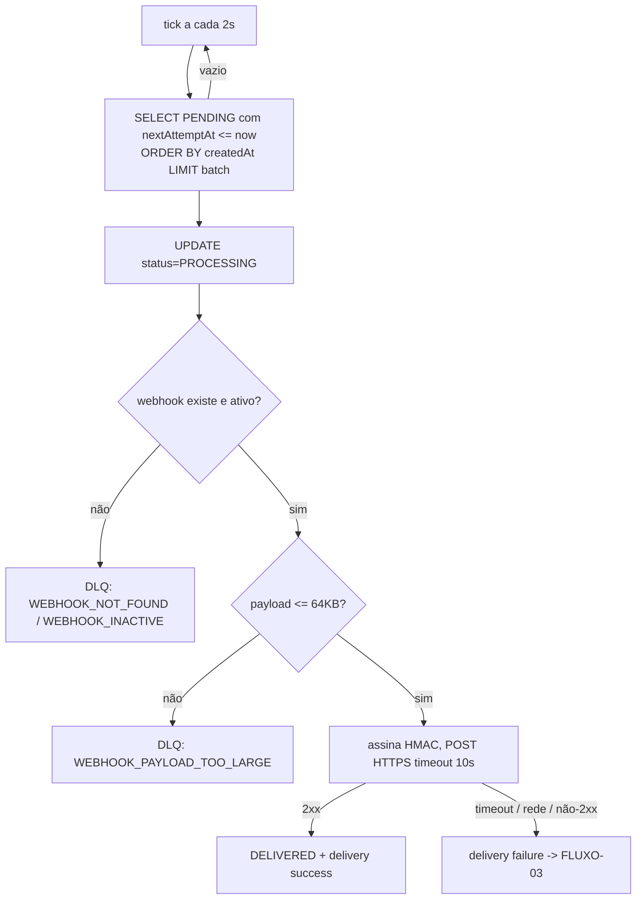

# FDD: Sistema de Webhooks de Notificação de Pedidos

| Campo | Valor |
|---|---|
| **Feature** | Webhooks outbound de mudança de status de pedido |
| **Módulo** | `src/modules/webhooks/` + entry-point `src/worker.ts` |
| **Status** | Pronto para revisão técnica (Bruno, Diego) e de segurança (Sofia) |
| **Base** | [RFC](RFC.md) · [ADR-001 a ADR-007](adrs/README.md) · [PRD](PRD.md) |

> Este documento descreve **como construir**. O porquê das decisões está nos ADRs e não é repetido aqui. Itens marcados como **(H-nn)** são **hipóteses de implementação**: não foram decididos na reunião, foram escolhidos para tornar o documento acionável e estão listados na [seção 13](#13-hipóteses-e-pontos-a-confirmar) para validação na revisão.

---

## 1. Contexto e motivação técnica

- O único ponto do sistema em que o status de um pedido muda depois da criação é `OrderService.changeStatus` em `src/modules/orders/order.service.ts`. Ele roda um `prisma.$transaction` que valida a transição (`canTransition` em `src/modules/orders/order.status.ts`), debita ou repõe estoque, atualiza `orders` e insere em `order_status_history`.
- Não existe mecanismo de eventos, fila ou HTTP de saída no projeto (`package.json` não tem broker nem cliente HTTP; Node `>=20` já traz `fetch` global).
- A feature precisa publicar esses eventos para endpoints HTTPS de clientes B2B com latência de até 10 s ([09:02] Marcos), sem acoplar a transação de status à disponibilidade do cliente ([09:04] Bruno).

**Atores:** usuário autenticado que representa o cliente e gerencia webhooks pela API ([09:32] Marcos); usuário `ADMIN` que faz replay da DLQ ([09:36] Sofia); worker (processo de sistema); endpoint HTTPS do cliente (sistema externo).

## 2. Objetivos técnicos

| ID | Objetivo | Meta verificável |
|---|---|---|
| FDD-OBJ-01 | Atomicidade entre mudança de status e registro do evento | 0 casos de status alterado sem linha na outbox para webhooks interessados; falha na outbox faz rollback do status ([09:40] Bruno) |
| FDD-OBJ-02 | Latência de entrega | Primeira tentativa iniciada em ≤ 2 s após o commit, em condição normal (polling de 2 s, [09:09] Diego); entrega fim a fim < 10 s para clientes saudáveis ([09:02] Marcos) |
| FDD-OBJ-03 | Resiliência a indisponibilidade do cliente | Envio inicial + 5 retentativas em 1m/5m/30m/2h/12h, ~14,6 h de janela ([09:17] Diego) |
| FDD-OBJ-04 | Autenticidade e integridade | 100% das entregas com `X-Signature` HMAC-SHA256 válido para a secret do endpoint ([09:22] Sofia) |
| FDD-OBJ-05 | Idempotência no consumidor | `X-Event-Id` estável entre retentativas e replays ([09:25] Diego) |
| FDD-OBJ-06 | Zero regressão no fluxo de pedidos | Testes existentes em `tests/orders.test.ts` continuam passando sem alteração de asserções |

## 3. Escopo e exclusões

**Incluso**
- Tabelas `webhooks`, `webhook_outbox`, `webhook_dead_letter`, `webhook_deliveries` e migração Prisma.
- Função `publishWebhookEvent(tx, order, fromStatus, toStatus)` chamada em `changeStatus` ([09:41] Bruno).
- Worker `src/worker.ts` + `src/modules/webhooks/webhook.processor.ts`, script `npm run worker` ([09:11] Larissa, [09:28] Bruno).
- CRUD de configuração, rotação de secret, histórico de entregas, replay administrativo da DLQ.
- Assinatura HMAC-SHA256, headers de entrega, timeout de 10 s, limite de 64 KB.

**Excluído (com origem)**
| Item | Motivo | Origem |
|---|---|---|
| Webhooks inbound (cliente enviando para nós) | Fluxo é apenas outbound | [09:02] Marcos |
| E-mail ao cliente quando o webhook falha | Próxima fase | [09:37] Larissa |
| Rate limiting de saída | Observar e decidir depois | [09:39] Larissa |
| Dashboard visual para o cliente | Projeto separado do time de frontend | [09:40] Larissa |
| Arquivamento de linhas entregues (~30 dias) | Fora do escopo desta feature | [09:08] Diego |
| Múltiplos workers / ordem global | Futuro; single-worker agora | [09:13] Diego |
| Exactly-once | Descartado em favor de at-least-once | [09:25] Diego |
| Itens do pedido no payload | Payload enxuto; cliente consulta `GET /orders/:id` | [09:43] Diego |
| Evento na **criação** do pedido (`OrderService.create`) | A reunião restringiu a integração a `changeStatus` ([09:40] Bruno); `create` nasce sempre em `PENDING` e nenhuma transição em `order.status.ts` leva a `PENDING` | [09:40] Bruno · `src/modules/orders/order.status.ts` |

## 4. Modelo de dados e fluxos detalhados

### 4.1 Modelo de dados (Prisma, MySQL)

Convenções herdadas de `prisma/schema.prisma`: UUID em `CHAR(36)`, `@@map` em snake_case, `createdAt`/`updatedAt` ([09:51] Larissa).

```prisma
enum WebhookOutboxStatus {
  PENDING      // aguardando envio ou próxima retentativa
  PROCESSING   // reservado pelo worker
  DELIVERED    // 2xx recebido
  FAILED       // terminal: copiado para webhook_dead_letter
}

model Webhook {
  id                      String    @id @default(uuid()) @db.Char(36)
  customerId              String    @db.Char(36)
  url                     String    @db.VarChar(2048)
  secret                  String    @db.VarChar(128)   // ver RFC-Q-07 (armazenamento)
  previousSecret          String?   @db.VarChar(128)
  previousSecretExpiresAt DateTime?
  events                  Json      // array de OrderStatus assinados
  active                  Boolean   @default(true)
  createdAt               DateTime  @default(now())
  updatedAt               DateTime  @updatedAt

  customer Customer @relation(fields: [customerId], references: [id], onDelete: Cascade)

  @@index([customerId, active])
  @@map("webhooks")
}

model WebhookOutbox {
  id            String              @id @default(uuid()) @db.Char(36)
  eventId       String              @unique @db.Char(36)   // X-Event-Id
  webhookId     String              @db.Char(36)           // sem FK: preserva evidência (H-01)
  orderId       String              @db.Char(36)
  eventType     String              @db.VarChar(64)        // "order.status_changed"
  payload       Json                                      // snapshot renderizado
  status        WebhookOutboxStatus @default(PENDING)
  attempts      Int                 @default(0)
  nextAttemptAt DateTime            @default(now())
  lastError     String?             @db.VarChar(500)
  deliveredAt   DateTime?
  createdAt     DateTime            @default(now())
  updatedAt     DateTime            @updatedAt

  @@index([status, createdAt])
  @@index([status, nextAttemptAt])
  @@index([orderId])
  @@map("webhook_outbox")
}

model WebhookDeadLetter {
  id           String    @id @default(uuid()) @db.Char(36)
  outboxId     String    @db.Char(36)
  eventId      String    @db.Char(36)
  webhookId    String    @db.Char(36)
  payload      Json
  reason       String    @db.VarChar(64)    // código WEBHOOK_*
  lastError    String?   @db.Text
  attempts     Int
  failedAt     DateTime  @default(now())
  replayedAt   DateTime?
  replayedById String?   @db.Char(36)

  @@index([webhookId])
  @@index([failedAt])
  @@map("webhook_dead_letter")
}

model WebhookDelivery {
  id             String   @id @default(uuid()) @db.Char(36)
  outboxId       String   @db.Char(36)
  eventId        String   @db.Char(36)
  webhookId      String   @db.Char(36)
  attempt        Int
  success        Boolean
  requestPayload Json
  responseStatus Int?
  responseBody   String?  @db.Text      // truncado em 4 KB (H-02)
  durationMs     Int
  errorCode      String?  @db.VarChar(64)
  createdAt      DateTime @default(now())

  @@index([webhookId, createdAt])
  @@map("webhook_deliveries")
}
```

Origem das tabelas: outbox ([09:06] Diego), índices em status e `created_at` ([09:08] Diego), DLQ separada com payload, motivo e timestamp ([09:18] Diego), configuração com url + secret + customer_id + ativo ([09:21] Bruno), histórico de entregas com sucesso/falha, payload, response e tempo de resposta ([09:34] Marcos).

### 4.2 FDD-FLUXO-01: criação do evento na outbox (dentro de `changeStatus`)

```mermaid
sequenceDiagram
    participant C as Controller
    participant S as OrderService.changeStatus
    participant P as publishWebhookEvent
    participant DB as MySQL (tx)
    C->>S: PATCH /orders/:id/status
    S->>DB: BEGIN; SELECT order; valida canTransition
    S->>DB: debita/repõe estoque (se aplicável)
    S->>DB: UPDATE orders; INSERT order_status_history
    S->>P: publishWebhookEvent(tx, order, from, to)
    P->>DB: SELECT webhooks WHERE customerId AND active
    P->>P: filtra por events ∋ to
    loop para cada webhook interessado
        P->>DB: INSERT webhook_outbox (eventId=uuid, payload snapshot, PENDING)
    end
    S->>DB: COMMIT (ou ROLLBACK de tudo se qualquer passo falhar)
```

1. `publishWebhookEvent` é chamado **depois** do `INSERT` em `order_status_history` e **antes** do `findUnique` final ([09:40] Bruno).
2. Busca webhooks `active = true` do `order.customerId`. Filtra em memória os que têm `to` em `events` ([09:33] Marcos, [09:34] Bruno).
3. Se nenhum se interessa, retorna `0` e nada é inserido ([09:34] Bruno).
4. Para cada webhook: gera `eventId` (UUID v4, pacote `uuid` já presente), monta o payload ([5.8](#58-fdd-contrato-08-requisição-outbound-para-o-cliente)) e insere com `status = PENDING`, `nextAttemptAt = now()` ([09:25] Diego, [09:52] Larissa).
5. Qualquer exceção propaga e o `$transaction` faz rollback de status, histórico e estoque ([09:41] Diego).
6. Cada linha inserida gera um log `debug` `webhook_event_enqueued`. Como ele é emitido dentro da transação, pode aparecer mesmo se houver rollback depois; a fonte de verdade é a tabela (H-03).

### 4.3 FDD-FLUXO-02: processamento pelo worker



1. **Inicialização** (`src/worker.ts`, espelhando `src/server.ts`): cria `PrismaClient` próprio via `createPrismaClient()` de `src/config/database.ts` ([09:30] Bruno); registra handlers de `SIGINT`/`SIGTERM`; **recupera órfãos**: `UPDATE webhook_outbox SET status='PENDING' WHERE status='PROCESSING'` (sobras de um crash anterior; seguro por ser at-least-once) (H-04).
2. **Loop**: a cada `WEBHOOK_POLL_INTERVAL_MS` (2000) ([09:09] Diego), executa um ciclo. O próximo ciclo só começa após o término do anterior (sem sobreposição).
3. **Seleção**: `status = PENDING AND nextAttemptAt <= now()` ordenado por `createdAt ASC`, `LIMIT WEBHOOK_BATCH_SIZE` (10, H-05) ([09:08] Diego, [09:12] Diego).
4. **Reserva**: `UPDATE ... SET status='PROCESSING'` nos IDs selecionados.
5. **Processamento sequencial** de cada linha do lote, na ordem de `createdAt` (preserva ordem por pedido com single-worker, [09:12] Diego):
   1. Carrega o `Webhook` por `webhookId`. Se não existe, vai para a DLQ com `WEBHOOK_NOT_FOUND`. Se `active = false`, vai para a DLQ com `WEBHOOK_INACTIVE` (H-06).
   2. Serializa `payload` e mede `Buffer.byteLength`. Acima de 65 536 bytes, vai direto para a DLQ com `WEBHOOK_PAYLOAD_TOO_LARGE`, **sem retry e sem truncar** ([09:23] Sofia, [09:24] Diego, [09:24] Larissa).
   3. Calcula `X-Signature` sobre o corpo exato que será enviado ([5.8](#58-fdd-contrato-08-requisição-outbound-para-o-cliente)).
   4. `fetch(url, { method: 'POST', body, headers, signal: AbortSignal.timeout(10_000) })` ([09:42] Diego).
   5. Grava uma linha em `webhook_deliveries` (sucesso ou falha, `durationMs`, `responseStatus`, `responseBody` truncado).
   6. **2xx**: `status = DELIVERED`, `deliveredAt = now()`, `attempts += 1`.
   7. **Falha**: segue o FDD-FLUXO-03.
6. **Erro inesperado no ciclo** (ex.: banco indisponível): loga `webhook_worker_cycle_failed` com `err` e tenta de novo no próximo tick; o processo não morre.
7. **Shutdown**: ao receber sinal, termina o envio em andamento (no máximo 10 s), não inicia novo ciclo, `prisma.$disconnect()` e `process.exit(0)`.

### 4.4 FDD-FLUXO-03: retry com backoff

Tabela fixa `RETRY_DELAYS = [1m, 5m, 30m, 2h, 12h]` ([09:17] Diego, [09:17] Larissa). `attempts` conta tentativas HTTP já feitas.

| Tentativa HTTP | Momento (relativo à 1ª falha) | Em caso de falha |
|---|---|---|
| 1 (envio inicial) | t0 | agenda +1 min |
| 2 | +1 min | agenda +5 min |
| 3 | +6 min | agenda +30 min |
| 4 | +36 min | agenda +2 h |
| 5 | +2 h 36 min | agenda +12 h |
| 6 | +14 h 36 min | DLQ com `WEBHOOK_MAX_ATTEMPTS_EXCEEDED` |

Algoritmo, após falha:
```ts
const retryIndex = row.attempts - 1;        // attempts já incrementado
if (retryIndex < RETRY_DELAYS.length) {
  status = 'PENDING';
  nextAttemptAt = now + RETRY_DELAYS[retryIndex];
  lastError = `${errorCode}: ${resumo}`;
} else {
  moveToDeadLetter(row, 'WEBHOOK_MAX_ATTEMPTS_EXCEEDED');
}
```
> A leitura "envio inicial + 5 retentativas" segue a soma de ~15 h citada em [09:17] Diego. Se a revisão confirmar "5 tentativas no total" ([09:48] Larissa), basta remover o último elemento de `RETRY_DELAYS` (RFC-Q-06).

**O que conta como falha** ([09:42] Diego): timeout de 10 s (`WEBHOOK_DELIVERY_TIMEOUT`), erro de rede/DNS/TLS (`WEBHOOK_DELIVERY_NETWORK_ERROR`) e qualquer status fora de `200-299` (`WEBHOOK_DELIVERY_HTTP_ERROR`). Redirecionamentos não são seguidos (`redirect: 'manual'`) e contam como falha (H-07).

### 4.5 FDD-FLUXO-04: DLQ e replay

**Mover para DLQ** (`moveToDeadLetter`, em uma transação):
1. `INSERT webhook_dead_letter` com `outboxId`, `eventId`, `webhookId`, `payload`, `reason` (código `WEBHOOK_*`), `lastError`, `attempts` ([09:18] Diego).
2. `UPDATE webhook_outbox SET status='FAILED'`.
3. Log `warn` `webhook_moved_to_dlq`.

**Replay** (`POST /api/v1/admin/webhooks/dead-letter/:id/replay`, [09:18] Diego), em uma transação:
1. Busca o registro na DLQ; se não existe, `WEBHOOK_DEAD_LETTER_NOT_FOUND`; se `replayedAt` preenchido, `WEBHOOK_DEAD_LETTER_ALREADY_REPLAYED` (H-08).
2. Recoloca a linha original da outbox como pendente: `status='PENDING'`, `attempts=0`, `nextAttemptAt=now()`, **mantendo o mesmo `eventId`** para o cliente deduplicar ([09:18] Diego, [09:25] Diego).
3. Marca `replayedAt = now()`, `replayedById = req.user.id`.
4. Log `info` `webhook_dlq_replayed` com `adminUserId`, `deadLetterId`, `eventId` para auditoria ([09:36] Sofia).

### 4.6 FDD-FLUXO-05: rotação de secret

1. Gera nova secret: `crypto.randomBytes(32).toString('hex')` (H-09).
2. Na mesma atualização: `previousSecret = secret atual`, `previousSecretExpiresAt = now + 24h`, `secret = nova` ([09:21] Sofia).
3. Responde a nova secret uma única vez.
4. Durante o grace period, o worker envia as duas assinaturas ([5.8](#58-fdd-contrato-08-requisição-outbound-para-o-cliente)); depois de `previousSecretExpiresAt`, só a nova (H-10).
5. Log `info` `webhook_secret_rotated` (sem a secret).

## 5. Contratos públicos

Todos os endpoints ficam sob `/api/v1` (`src/app.ts`), exigem `Authorization: Bearer <jwt>` (`authenticate`) e respondem erros no envelope existente `{ "error": { "code", "message", "details?" } }` (`src/middlewares/error.middleware.ts`). Os endpoints de configuração aceitam **qualquer role autenticada** ([09:37] Sofia). O `customerId` **não** vem do JWT ([09:32] Larissa); a posição (body/query) é proposta deste FDD (RFC-Q-04).

Valores aceitos em `events`: `PAID`, `PROCESSING`, `SHIPPED`, `DELIVERED`, `CANCELLED`. `PENDING` é recusado porque nenhuma transição de `changeStatus` leva a ele (`src/modules/orders/order.status.ts`).

### 5.1 FDD-CONTRATO-01: cadastrar webhook

`POST /api/v1/webhooks` ([09:31] Marcos)

Request
```json
{
  "customerId": "6f1c2a3e-8b1d-4c3a-9a7e-2f5b0c9d1e01",
  "url": "https://hooks.atlas.example/oms",
  "events": ["SHIPPED", "DELIVERED"]
}
```
Response `201 Created` (a `secret` só aparece aqui e na rotação, H-11)
```json
{
  "id": "0b8e3f52-6a1c-4d7e-b0f3-91a2c4d5e6f7",
  "customerId": "6f1c2a3e-8b1d-4c3a-9a7e-2f5b0c9d1e01",
  "url": "https://hooks.atlas.example/oms",
  "events": ["SHIPPED", "DELIVERED"],
  "active": true,
  "secret": "9f2c4e...a71b",
  "createdAt": "2026-11-19T12:00:00.000Z",
  "updatedAt": "2026-11-19T12:00:00.000Z"
}
```
Status: `201`; `400 VALIDATION_ERROR` (detalhes com `WEBHOOK_INVALID_URL` ou `WEBHOOK_INVALID_EVENTS`); `401 UNAUTHORIZED`; `404 WEBHOOK_CUSTOMER_NOT_FOUND`.

### 5.2 FDD-CONTRATO-02: listar webhooks de um cliente

`GET /api/v1/webhooks?customerId={uuid}&page=1&pageSize=20` ([09:33] Bruno)

Response `200 OK` (formato `paginated()` de `src/shared/http/response.ts`; sem `secret`)
```json
{
  "data": [
    {
      "id": "0b8e3f52-6a1c-4d7e-b0f3-91a2c4d5e6f7",
      "customerId": "6f1c2a3e-8b1d-4c3a-9a7e-2f5b0c9d1e01",
      "url": "https://hooks.atlas.example/oms",
      "events": ["SHIPPED", "DELIVERED"],
      "active": true,
      "secretRotationPendingUntil": null,
      "createdAt": "2026-11-19T12:00:00.000Z",
      "updatedAt": "2026-11-19T12:00:00.000Z"
    }
  ],
  "pagination": { "page": 1, "pageSize": 20, "total": 1, "totalPages": 1 }
}
```
Status: `200`; `400 VALIDATION_ERROR` (sem `customerId` ou não UUID); `401`.

### 5.3 FDD-CONTRATO-03: editar webhook

`PATCH /api/v1/webhooks/:id` ([09:33] Bruno). Todos os campos opcionais; `customerId` e `secret` não são editáveis.

Request
```json
{ "events": ["PAID", "SHIPPED", "DELIVERED", "CANCELLED"], "active": false }
```
Response `200 OK`: mesmo corpo do item de `5.2`, atualizado.
Status: `200`; `400 VALIDATION_ERROR`; `401`; `404 WEBHOOK_NOT_FOUND`.

Semântica: mudanças valem para eventos **futuros**; linhas já na outbox mantêm o snapshot ([ADR-007](adrs/ADR-007-payload-snapshot-e-filtro-na-insercao.md)). Se `active=false`, o worker não envia linhas pendentes desse webhook e as move para a DLQ com `WEBHOOK_INACTIVE` (H-06), de onde podem ser reprocessadas.

### 5.4 FDD-CONTRATO-04: remover webhook

`DELETE /api/v1/webhooks/:id` ([09:33] Bruno)

Request: sem corpo. Response: `204 No Content`, sem corpo.
Status: `204`; `401`; `404 WEBHOOK_NOT_FOUND`.

Semântica: remoção física da configuração. Outbox, DLQ e deliveries não têm FK para `webhooks` e preservam a evidência (H-01); linhas pendentes vão para a DLQ com `WEBHOOK_NOT_FOUND` no próximo ciclo.

### 5.5 FDD-CONTRATO-05: rotacionar secret

`POST /api/v1/webhooks/:id/rotate-secret` ([09:21] Sofia; caminho proposto, H-12)

Request: sem corpo. Response `200 OK`
```json
{
  "id": "0b8e3f52-6a1c-4d7e-b0f3-91a2c4d5e6f7",
  "secret": "c41d7b...09ee",
  "previousSecretExpiresAt": "2026-11-20T12:00:00.000Z"
}
```
Status: `200`; `401`; `404 WEBHOOK_NOT_FOUND`; `409 WEBHOOK_SECRET_ROTATION_IN_PROGRESS` se já houver uma rotação dentro das 24 h (evita perder a secret anterior ainda válida, H-13).

### 5.6 FDD-CONTRATO-06: histórico de entregas

`GET /api/v1/webhooks/:id/deliveries` ([09:34] Marcos). Retorna as **últimas 100** tentativas, mais recentes primeiro.

Response `200 OK`
```json
{
  "data": [
    {
      "id": "a3d9...",
      "eventId": "5d1f6a0c-2b7e-4f3a-8c9d-0e1f2a3b4c5d",
      "attempt": 2,
      "success": false,
      "requestPayload": { "event_id": "5d1f6a0c-...", "event_type": "order.status_changed", "...": "..." },
      "responseStatus": 503,
      "responseBody": "Service Unavailable",
      "durationMs": 184,
      "errorCode": "WEBHOOK_DELIVERY_HTTP_ERROR",
      "createdAt": "2026-11-19T12:01:02.000Z"
    }
  ]
}
```
Status: `200`; `401`; `404 WEBHOOK_NOT_FOUND`.

### 5.7 FDD-CONTRATO-07: replay de evento da DLQ (admin)

`POST /api/v1/admin/webhooks/dead-letter/:id/replay` ([09:18] Diego), protegido por `requireRole('ADMIN')` ([09:36] Larissa).

Request: sem corpo. Response `202 Accepted`
```json
{
  "deadLetterId": "e7c1...",
  "outboxId": "4b2a...",
  "eventId": "5d1f6a0c-2b7e-4f3a-8c9d-0e1f2a3b4c5d",
  "status": "PENDING",
  "replayedAt": "2026-11-19T15:30:00.000Z",
  "replayedBy": "c0ffee00-0000-4000-8000-000000000001"
}
```
Status: `202` (entrega é assíncrona); `401`; `403 FORBIDDEN` (role `OPERATOR`); `404 WEBHOOK_DEAD_LETTER_NOT_FOUND`; `409 WEBHOOK_DEAD_LETTER_ALREADY_REPLAYED`.

### 5.8 FDD-CONTRATO-08: requisição outbound para o cliente

`POST {webhook.url}` enviado pelo worker.

Headers ([09:44] Diego, [09:44] Sofia, [09:45] Diego)

| Header | Valor | Semântica |
|---|---|---|
| `Content-Type` | `application/json` | Corpo JSON UTF-8 |
| `X-Event-Id` | UUID do evento | Igual em retentativas e replays; chave de deduplicação ([09:25] Diego) |
| `X-Webhook-Id` | `id` do webhook | Identifica qual cadastro gerou o envio ([09:44] Sofia) |
| `X-Timestamp` | ISO 8601 do envio | Permite ao cliente detectar replay se quiser ([09:44] Diego) |
| `X-Signature` | `sha256=<hex>` | `HMAC-SHA256(secret, rawBody)` ([09:22] Sofia). Durante rotação: `sha256=<hex_nova>,sha256=<hex_anterior>` (H-10) |

Corpo (snapshot gravado na outbox, [09:43] Diego)
```json
{
  "event_id": "5d1f6a0c-2b7e-4f3a-8c9d-0e1f2a3b4c5d",
  "event_type": "order.status_changed",
  "timestamp": "2026-11-19T12:00:00.000Z",
  "order_id": "9a8b7c6d-5e4f-4a3b-8c2d-1e0f9a8b7c6d",
  "order_number": "ORD-000123",
  "from_status": "PROCESSING",
  "to_status": "SHIPPED",
  "customer_id": "6f1c2a3e-8b1d-4c3a-9a7e-2f5b0c9d1e01",
  "total_cents": 125990
}
```
`timestamp` é o instante da mudança de status. `order_number` segue o formato `ORD-000000` de `reserveOrderNumber` em `order.service.ts`.

Resposta esperada do cliente: qualquer `2xx` em até 10 s; o corpo é ignorado (guardado truncado em `webhook_deliveries`).

Verificação no cliente (para o portal do desenvolvedor, [09:26] Marcos):
```ts
const expected = 'sha256=' + crypto.createHmac('sha256', secret).update(rawBody).digest('hex');
const ok = header.split(',').some((sig) => crypto.timingSafeEqual(Buffer.from(sig), Buffer.from(expected)));
```

### 5.9 FDD-CONTRATO-09: interface interna `publishWebhookEvent`

```ts
// src/modules/webhooks/webhook.publisher.ts
export async function publishWebhookEvent(
  tx: Prisma.TransactionClient,
  order: Pick<Order, 'id' | 'orderNumber' | 'customerId' | 'totalCents'>,
  fromStatus: OrderStatus,
  toStatus: OrderStatus,
): Promise<number>; // quantidade de linhas inseridas na outbox
```
Função pura sobre o `tx` recebido, sem repositório injetado ([09:41] Bruno, [09:41] Diego). Nunca captura exceções: falhar aqui deve abortar a transação.

## 6. Matriz de erros previstos

Novas classes em `src/modules/webhooks/webhook.errors.ts`, estendendo `AppError` de `src/shared/errors/app-error.ts` (mesmo padrão de `InvalidStatusTransitionError` e `InsufficientStockError`) ([09:28] Bruno, [09:29] Larissa).

**API (síncronos, tratados pelo `errorMiddleware` sem alteração)**

| ID | Código | HTTP | Quando | Tratamento |
|---|---|---|---|---|
| FDD-ERR-01 | `WEBHOOK_NOT_FOUND` | 404 | `:id` de webhook inexistente em PATCH, DELETE, rotate, deliveries | `WebhookNotFoundError` |
| FDD-ERR-02 | `WEBHOOK_INVALID_URL` | 400 | URL malformada ou não `https` ([09:23] Sofia) | Regra no schema Zod; chega como `VALIDATION_ERROR` com `details[].path = "url"` e `message` iniciando por `WEBHOOK_INVALID_URL` (ver nota) |
| FDD-ERR-03 | `WEBHOOK_INVALID_EVENTS` | 400 | `events` vazio, com duplicatas ou com status fora da lista aceita | Mesmo mecanismo da linha anterior, `path = "events"` |
| FDD-ERR-04 | `WEBHOOK_CUSTOMER_NOT_FOUND` | 404 | `customerId` inexistente na criação | `WebhookCustomerNotFoundError` |
| FDD-ERR-05 | `WEBHOOK_SECRET_ROTATION_IN_PROGRESS` | 409 | Rotação pedida com grace period ainda ativo (H-13) | `ConflictError` com código próprio |
| FDD-ERR-06 | `WEBHOOK_DEAD_LETTER_NOT_FOUND` | 404 | Replay de `:id` inexistente na DLQ | `WebhookDeadLetterNotFoundError` |
| FDD-ERR-07 | `WEBHOOK_DEAD_LETTER_ALREADY_REPLAYED` | 409 | Replay repetido (H-08) | `ConflictError` com código próprio |
| (existente) | `FORBIDDEN` | 403 | Replay por usuário sem role `ADMIN` | `requireRole('ADMIN')` |
| (existente) | `INTERNAL_SERVER_ERROR` | 500 | Falha ao inserir na outbox dentro de `changeStatus` | Rollback completo da mudança de status ([09:40] Bruno); log `error` existente do middleware |

> **Nota sobre validação:** `src/middlewares/validate.middleware.ts` converte qualquer `ZodError` em `ValidationError` (`VALIDATION_ERROR`) e copia `issue.message` para `details`. Para manter a validação no schema, como pediu a Sofia ([09:23] Sofia), sem alterar o middleware, os códigos `WEBHOOK_INVALID_URL`/`WEBHOOK_INVALID_EVENTS` vão como prefixo da mensagem do issue. Se a revisão preferir o código no topo do envelope, a alternativa é o `WebhookService` relançar como `AppError` próprio.

**Worker (assíncronos, gravados em `webhook_deliveries.errorCode` ou `webhook_dead_letter.reason`)**

| ID | Código | Quando | Retry? | Destino |
|---|---|---|---|---|
| FDD-ERR-08 | `WEBHOOK_DELIVERY_TIMEOUT` | Sem resposta em 10 s ([09:42] Diego) | Sim | Backoff |
| FDD-ERR-09 | `WEBHOOK_DELIVERY_HTTP_ERROR` | Status fora de 2xx (inclui 3xx, H-07) | Sim | Backoff |
| FDD-ERR-10 | `WEBHOOK_DELIVERY_NETWORK_ERROR` | DNS, conexão recusada, erro TLS | Sim | Backoff |
| FDD-ERR-11 | `WEBHOOK_MAX_ATTEMPTS_EXCEEDED` | Falha na 6ª tentativa | Não | DLQ |
| FDD-ERR-12 | `WEBHOOK_PAYLOAD_TOO_LARGE` | Corpo > 64 KB ([09:24] Larissa) | Não | DLQ |
| FDD-ERR-13 | `WEBHOOK_SECRET_REQUIRED` | Webhook sem secret no momento de assinar (inconsistência de dados) ([09:28] Bruno) | Não | DLQ |
| FDD-ERR-14 | `WEBHOOK_INACTIVE` | Webhook desativado com eventos pendentes (H-06) | Não | DLQ |
| FDD-ERR-15 | `WEBHOOK_NOT_FOUND` | Webhook removido com eventos pendentes (H-01) | Não | DLQ |

## 7. Estratégias de resiliência

| Mecanismo | Valor | Configuração | Origem |
|---|---|---|---|
| Polling | 2 000 ms | `WEBHOOK_POLL_INTERVAL_MS` | [09:09] Diego |
| Tamanho de lote | 10 | `WEBHOOK_BATCH_SIZE` | "batch pequeno" [09:08] Diego (valor H-05) |
| Timeout HTTP | 10 000 ms | `WEBHOOK_HTTP_TIMEOUT_MS` | [09:42] Diego |
| Retentativas | 5 após o envio inicial | constante `RETRY_DELAYS` | [09:17] Larissa |
| Backoff | 1m, 5m, 30m, 2h, 12h | constante `RETRY_DELAYS` | [09:17] Diego |
| Limite de payload | 65 536 bytes | constante | [09:24] Diego |
| Grace period de secret | 24 h | constante | [09:21] Sofia |

- Variáveis novas entram em `src/config/env.ts` com `z.coerce.number()` e defaults, como `PORT`.
- **Fallback:** não há canal alternativo (e-mail adiado, [09:37] Larissa). O fallback é a DLQ + replay manual.
- **Circuit breaker:** não adotado; o backoff por evento já reduz pressão sobre um cliente indisponível. Rate limiting fica em observação (RFC-Q-01).
- **Invariantes:**
  1. Nenhuma linha de outbox existe sem a mudança de status correspondente comitada, e vice-versa (para webhooks interessados).
  2. `eventId` nunca muda depois de criado.
  3. Uma linha `FAILED` na outbox sempre tem uma linha correspondente na DLQ.
  4. Só existe uma instância de worker em execução (garantido operacionalmente; ver risco R-03).

## 8. Observabilidade

O projeto hoje tem apenas o logger Pino (`src/shared/logger/index.ts`) e o `requestLogger` com `X-Request-Id` (`src/middlewares/request-logger.middleware.ts`). Não há stack de métricas nem de tracing em `package.json`. Esta fase **não adiciona dependências** ([09:29] Bruno); métricas são derivadas de logs estruturados e de consultas às tabelas.

**Logs** (Pino, eventos em snake_case como os existentes `server_started`/`http_request`; base `service` sobrescrita para `order-management-worker` no worker)

| Evento | Nível | Campos |
|---|---|---|
| `webhook_worker_started` / `webhook_worker_stopped` | info | `pollIntervalMs`, `batchSize`, `recoveredOrphans` |
| `webhook_event_enqueued` | debug | `orderId`, `webhookId`, `eventId`, `toStatus` |
| `webhook_delivery_succeeded` | info | `eventId`, `webhookId`, `orderId`, `attempt`, `responseStatus`, `durationMs` |
| `webhook_delivery_failed` | warn | os acima + `errorCode`, `nextAttemptAt` |
| `webhook_moved_to_dlq` | warn | `eventId`, `webhookId`, `reason`, `attempts` |
| `webhook_dlq_replayed` | info | `deadLetterId`, `eventId`, `adminUserId`, `requestId` ([09:36] Sofia) |
| `webhook_secret_rotated` | info | `webhookId`, `userId`, `previousSecretExpiresAt` |
| `webhook_worker_cycle_failed` | error | `err` |
| `webhook_worker_stats` | info, a cada 60 s (H-14) | `pendingCount`, `oldestPendingAgeMs`, `dlqCountLast24h` |

Proteção de dados: adicionar `*.secret`, `*.previousSecret` e `*.signature` aos `redactPaths` existentes. Nunca logar o header `X-Signature` nem o payload completo em `info`.

**Métricas** (nomes estáveis, emitidas como campos de log nesta fase e prontas para um exportador futuro)

| Métrica | Tipo | Fonte | Uso |
|---|---|---|---|
| `webhook_delivery_latency_ms` | histograma | `deliveredAt - createdAt` da outbox | Validar < 10 s ([09:02] Marcos) |
| `webhook_delivery_attempts_total{result}` | contador | `webhook_deliveries` | Taxa de sucesso por tentativa |
| `webhook_http_duration_ms` | histograma | `webhook_deliveries.durationMs` | Detectar clientes lentos |
| `webhook_outbox_pending` | gauge | `COUNT(*) WHERE status='PENDING'` | Backlog |
| `webhook_outbox_oldest_pending_age_ms` | gauge | `MIN(createdAt)` de pendentes vencidos | Worker parado ou atrasado |
| `webhook_dlq_total` | contador | `webhook_dead_letter` | Falhas permanentes |
| `webhook_enqueued_total{to_status}` | contador | outbox | Volume, insumo para RFC-Q-01 (rate limiting) |

**Tracing (correlação)**
- Sem biblioteca de tracing; a correlação é por identificadores propagados em todos os logs: `orderId` → `eventId` (gerado na outbox) → `outboxId` → registros de `webhook_deliveries` → header `X-Event-Id` no cliente.
- Um "trace" de evento é reconstruído filtrando os logs por `eventId`. O cliente pode citar o `X-Event-Id` em chamados de suporte.
- Spans lógicos documentados para quando houver OpenTelemetry: `webhook.enqueue` (dentro de `changeStatus`), `webhook.worker.cycle`, `webhook.deliver` (atributos `event_id`, `webhook_id`, `attempt`, `http.status_code`).

**Alertas sugeridos:** `oldest_pending_age_ms > 10 000` por 5 min (worker parado); crescimento da DLQ acima do normal; taxa de falha de um `webhookId` acima de 50% em 1 h.

## 9. Dependências e compatibilidade

| Dependência | Versão | Uso |
|---|---|---|
| Node.js | `>=20` (`package.json` `engines`) | `fetch` global, `AbortSignal.timeout`, `crypto` |
| Prisma / `@prisma/client` | 5.22.0 | Novos modelos e migração |
| MySQL | 8.0 (`docker-compose.yml`) | Outbox, DLQ, deliveries |
| `uuid` | 11.0.3 (já instalado) | `eventId` |
| `zod`, `pino`, `express` | versões atuais | Sem mudança |

- **Nenhuma dependência nova.**
- **Compatibilidade:** endpoints existentes inalterados. `PATCH /orders/:id/status` mantém contrato e status codes; só ganha um caminho novo de `500` se a outbox falhar (desejado, [09:40] Bruno).
- **Migração:** aditiva (quatro tabelas e um enum). `Customer` ganha a relação `webhooks Webhook[]`. Rollback da migração remove apenas tabelas novas.
- **Deploy:** novo processo `npm run worker` com a mesma `DATABASE_URL` da API ([09:11] Diego). A ordem de deploy é migração, depois API, depois worker. Exatamente uma réplica de worker.

## 10. Critérios de aceite técnicos

| ID | Critério |
|---|---|
| FDD-AC-01 | Mudar status com webhook interessado cria exatamente 1 linha `PENDING` por webhook, na mesma transação. |
| FDD-AC-02 | Forçar erro no `INSERT` da outbox faz `PATCH /orders/:id/status` retornar 500, e status, `order_status_history` e estoque permanecem inalterados. |
| FDD-AC-03 | Status não assinado por nenhum webhook do cliente não cria linha na outbox. |
| FDD-AC-04 | Com o worker rodando e cliente respondendo 200, o evento chega em < 10 s em p95 (teste com servidor HTTP local). |
| FDD-AC-05 | Cliente que responde 500 gera tentativas em +1m, +5m, +30m, +2h, +12h (teste com relógio simulado) e depois uma linha na DLQ com `WEBHOOK_MAX_ATTEMPTS_EXCEEDED`. |
| FDD-AC-06 | Cliente que demora > 10 s gera `WEBHOOK_DELIVERY_TIMEOUT` e retry. |
| FDD-AC-07 | `X-Signature` confere com `HMAC-SHA256(secret, rawBody)`; após rotação, duas assinaturas por 24 h e depois só a nova. |
| FDD-AC-08 | `X-Event-Id` é idêntico em todas as tentativas e após replay. |
| FDD-AC-09 | `POST /webhooks` com URL `http://` retorna 400; a resposta contém `WEBHOOK_INVALID_URL`. |
| FDD-AC-10 | Replay com usuário `OPERATOR` retorna 403; com `ADMIN` retorna 202, gera log `webhook_dlq_replayed` com `adminUserId`, e o evento volta a `PENDING`. |
| FDD-AC-11 | Payload > 64 KB vai para a DLQ sem nenhuma chamada HTTP. |
| FDD-AC-12 | `GET /webhooks/:id/deliveries` retorna no máximo 100 itens, em ordem decrescente. |
| FDD-AC-13 | Matar o worker com linhas `PROCESSING` e reiniciar faz essas linhas serem reenviadas. |
| FDD-AC-14 | `npm test` passa, incluindo `tests/orders.test.ts` sem mudança de asserções; nova suíte `tests/webhooks.test.ts`. |
| FDD-AC-15 | Revisão de segurança da Sofia (HMAC e geração de secret) concluída antes do deploy ([09:46] Sofia). |

## 11. Riscos e mitigação

| ID | Risco | Prob. | Impacto | Mitigação |
|---|---|---|---|---|
| R-01 | Inserção na outbox falha e bloqueia mudanças de status | Baixa | Alto | Inserção simples sem lógica externa; teste FDD-AC-02; alerta em 500 de `PATCH /orders/:id/status` |
| R-02 | **Inversão de ordem por retry**: evento A do pedido X em backoff, evento B do mesmo pedido entregue antes | Média | Médio | Payload traz `timestamp`, `from_status` e `to_status`; portal orienta descartar eventos mais antigos que o último aplicado. Bloquear eventos posteriores do mesmo pedido fica para revisão (não discutido) |
| R-03 | Duas instâncias de worker rodando por engano (envio duplicado e perda de ordem) | Média | Médio | Documentar réplica única no deploy; at-least-once já tolera duplicatas; particionamento/lock fica para RFC-Q-02 |
| R-04 | Cliente lento (10 s por envio) atrasa todo o lote com single-worker | Média | Médio | Timeout de 10 s; lote pequeno; métrica `webhook_http_duration_ms`; reavaliar com dados (RFC-Q-01, RFC-Q-02) |
| R-05 | Vazamento de secret | Baixa | Alto | Secret por endpoint ([09:21] Sofia); rotação com grace; redaction nos logs; revisão de segurança |
| R-06 | Crescimento contínuo de `webhook_outbox` e `webhook_deliveries` | Alta | Baixo | Índices em `status`/`createdAt`; arquivamento fica para depois ([09:08] Diego) |
| R-07 | SSRF: cliente cadastra URL https apontando para rede interna | Média | Alto | Não discutido na reunião; levar à revisão de segurança da Sofia |
| R-08 | Prazo (fim de novembro) apertado para 3 sprints | Média | Alto | Ordem de entrega da [seção 12.3](#123-ordem-de-implementação-sugerida); revisão de segurança reservada no fim ([09:47] Larissa) |

## 12. Integração com o sistema existente

### 12.1 Arquivos existentes impactados

| Arquivo | Integração |
|---|---|
| `src/modules/orders/order.service.ts` | **Alteração crítica.** Em `changeStatus`, após `tx.orderStatusHistory.create(...)` e antes do `tx.order.findUnique` final, adicionar `await publishWebhookEvent(tx, order, from, to);`. O `order` carregado já tem `id`, `orderNumber`, `customerId` e `totalCents`; o `TxClient` (`Prisma.TransactionClient`) já é o tipo usado por `debitStock`. Construtor e assinatura do service não mudam ([09:40] Bruno, [09:41] Bruno). |
| `src/modules/orders/order.status.ts` | Fonte da lista de status válidos para `events`. Como nenhuma transição leva a `PENDING`, o schema do webhook recusa `PENDING`. Nenhuma alteração no arquivo. |
| `src/shared/errors/app-error.ts` e `src/shared/errors/http-errors.ts` | Base dos novos erros em `src/modules/webhooks/webhook.errors.ts`. Como `NotFoundError` fixa o código `NOT_FOUND`, os erros 404 do módulo estendem `AppError` diretamente; os 409 estendem `ConflictError`, que aceita código customizado, como já faz `InvalidStatusTransitionError` ([09:28] Bruno). |
| `src/middlewares/error.middleware.ts` | **Sem alteração.** O ramo `err instanceof AppError` já serializa `statusCode`, `errorCode` e `details` dos novos erros ([09:29] Bruno). |
| `src/middlewares/auth.middleware.ts` | `authenticate` em todas as rotas de webhooks; `requireRole('ADMIN')` no replay, como já faz `src/modules/users/user.routes.ts` ([09:36] Larissa). `req.user.id` alimenta `replayedById`. |
| `src/middlewares/validate.middleware.ts` | Aplica `webhook.schemas.ts` em body, query e params. Ver a nota da seção 6 sobre o mapeamento para `VALIDATION_ERROR`. |
| `src/routes/index.ts` | Estender `Controllers` com `webhooks` e `adminWebhooks`; montar `router.use('/webhooks', buildWebhookRouter(...))` e `router.use('/admin/webhooks', buildAdminWebhookRouter(...))`. |
| `src/app.ts` | Em `buildControllers`, instanciar `WebhookRepository(prisma)`, `WebhookService` e `WebhookController`, como nos módulos existentes. |
| `src/server.ts` | Modelo para `src/worker.ts`: mesmo padrão de `bootstrap()`, handlers de `SIGINT`/`SIGTERM` com `prisma.$disconnect()` e `logger.fatal` em falha de bootstrap. |
| `src/config/database.ts` | O worker chama `createPrismaClient()` para ter instância própria no seu processo, com a mesma `DATABASE_URL` ([09:30] Bruno). |
| `src/config/env.ts` | Adicionar `WEBHOOK_POLL_INTERVAL_MS`, `WEBHOOK_BATCH_SIZE` e `WEBHOOK_HTTP_TIMEOUT_MS` com defaults; `.env.example` documenta as três. |
| `src/shared/logger/index.ts` | Reuso do `logger` ([09:29] Bruno); acrescentar `*.secret`, `*.previousSecret` e `*.signature` em `redactPaths`. |
| `src/shared/http/response.ts` | `paginated()` na listagem de webhooks. |
| `prisma/schema.prisma` | Novos modelos da [seção 4.1](#41-modelo-de-dados-prisma-mysql) e relação `webhooks Webhook[]` em `Customer`; nova pasta em `prisma/migrations/`. |
| `package.json` | Scripts `"worker": "node --env-file=.env dist/worker.js"` e `"worker:dev": "tsx watch --env-file=.env src/worker.ts"` ([09:11] Larissa). `tsconfig.build.json` já compila `src/`. |
| `tests/setup.ts` | Incluir `deleteMany` das quatro tabelas novas **antes** de `customer.deleteMany()` no `beforeEach`. |
| `tests/helpers/factories.ts` | Novas factories `createTestWebhook`; reaproveitar `getTestApp` e `createTestUser({ role: 'ADMIN' })`. |

### 12.2 Arquivos novos

```
src/worker.ts
src/modules/webhooks/
├── webhook.controller.ts       # CRUD, rotate-secret, deliveries
├── webhook.admin.controller.ts # replay DLQ
├── webhook.routes.ts           # buildWebhookRouter, buildAdminWebhookRouter
├── webhook.schemas.ts          # Zod: https, events, customerId, params
├── webhook.service.ts
├── webhook.repository.ts
├── webhook.errors.ts           # WEBHOOK_*
├── webhook.publisher.ts        # publishWebhookEvent(tx, ...)
├── webhook.processor.ts        # loop, envio, retry, DLQ
├── webhook.signer.ts           # HMAC-SHA256, geração de secret
└── webhook.payload.ts          # snapshot do payload
tests/webhooks.test.ts
```

### 12.3 Ordem de implementação sugerida

Alinhada à estimativa da reunião ([09:46] Larissa):
1. **Sprint 1:** schema Prisma, migração, `publishWebhookEvent` e integração em `changeStatus` com testes de atomicidade (FDD-AC-01 a 03).
2. **Sprint 2:** `webhook.processor.ts`, `src/worker.ts`, signer, retry, DLQ (FDD-AC-04 a 08, 11, 13).
3. **Sprint 3:** CRUD, rotação, deliveries, replay admin, observabilidade, testes ponta a ponta, **2 dias úteis de revisão de segurança** (FDD-AC-09, 10, 12, 14, 15).

## 13. Hipóteses e pontos a confirmar

Decisões de implementação **não tomadas na reunião**, escolhidas para tornar o FDD acionável. Devem ser validadas na sessão de revisão com Bruno e Diego ([09:50] Larissa) e na revisão de segurança.

| ID | Hipótese |
|---|---|
| H-01 | Outbox, DLQ e deliveries guardam `webhookId` sem FK, para preservar evidência após `DELETE`. |
| H-02 | `responseBody` truncado em 4 KB. |
| H-03 | Log de enfileiramento em `debug` dentro da transação. |
| H-04 | Linhas `PROCESSING` órfãs voltam a `PENDING` na inicialização do worker. |
| H-05 | Lote de 10 eventos por ciclo. |
| H-06 | Eventos de webhook inativo vão para a DLQ com `WEBHOOK_INACTIVE` em vez de serem enviados. |
| H-07 | Redirecionamentos (3xx) não são seguidos e contam como falha. |
| H-08 | Replay só é permitido uma vez por registro da DLQ. |
| H-09 | Secret de 32 bytes aleatórios em hex. |
| H-10 | Durante o grace period, `X-Signature` carrega as duas assinaturas separadas por vírgula. |
| H-11 | Secret exibida apenas na criação e na rotação. |
| H-12 | Caminho `POST /webhooks/:id/rotate-secret`. |
| H-13 | Nova rotação bloqueada enquanto houver grace period ativo. |
| H-14 | Log de estatísticas do worker a cada 60 s. |
