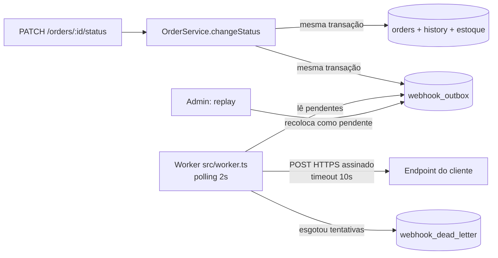

# RFC-001: Sistema de Webhooks de Notificação de Pedidos

| Campo | Valor |
|---|---|
| **Autora** | Larissa (Tech Lead) |
| **Status** | Em revisão |
| **Data** | dia da reunião técnica registrada em `TRANSCRICAO.md` (quinta-feira, 09:00) |
| **Revisores** | Bruno (Pedidos), Diego (Plataforma), Sofia (Segurança), Marcos (Produto) |
| **Documentos relacionados** | [PRD](PRD.md) · [FDD](FDD.md) · [ADRs](adrs/README.md) · [Tracker](TRACKER.md) |

> Esta RFC consolida o que foi decidido na reunião técnica e abre para revisão os pontos que ficaram em aberto. Ela responde **o que propomos e por quê**; o **como construir** está no [FDD](FDD.md).

---

## 1. Resumo (TL;DR)

Propomos notificar clientes B2B sobre mudanças de status de pedidos via **webhooks outbound assinados**. A mudança de status grava um evento numa **tabela outbox no MySQL, na mesma transação** ([ADR-001](adrs/ADR-001-outbox-no-mysql.md)). Um **worker em processo separado** lê a outbox **a cada 2 s** e faz o POST HTTPS para o cliente ([ADR-002](adrs/ADR-002-worker-separado-em-polling.md)). Falhas são retentadas com **backoff 1m/5m/30m/2h/12h** e, esgotadas, vão para uma **DLQ** com replay manual por admin ([ADR-003](adrs/ADR-003-retry-com-backoff-e-dlq.md)). Cada entrega é assinada com **HMAC-SHA256 usando uma secret por endpoint**, rotacionável com 24 h de convivência ([ADR-004](adrs/ADR-004-autenticacao-hmac-sha256-secret-por-endpoint.md)). A garantia é **at-least-once** com `X-Event-Id` para deduplicação ([ADR-005](adrs/ADR-005-entrega-at-least-once-com-x-event-id.md)). Tudo como um módulo comum do projeto, sem infraestrutura nova ([ADR-006](adrs/ADR-006-reuso-dos-padroes-do-projeto.md)). Estimativa: **3 sprints**, incluindo revisão de segurança.

## 2. Contexto e problema

- Atlas Comercial, MaxDistribuição e Nova Cargo pediram formalmente notificação em tempo real de mudança de status. Hoje fazem polling em `GET /orders`, o que deixa a integração lenta e cara; a Atlas sinalizou possível migração para um concorrente se não houver entrega até o fim do trimestre ([09:00] Marcos).
- Para eles, "tempo real" é **menos de 10 segundos** ([09:02] Marcos).
- O OMS não tem nenhum mecanismo de evento, fila ou notificação externa. A mudança de status vive em `OrderService.changeStatus` (`src/modules/orders/order.service.ts`), numa transação que já atualiza `orders`, `order_status_history` e estoque ([09:04] Bruno).
- O fluxo é apenas de saída: nós notificamos, clientes não enviam webhooks para nós ([09:02] Marcos).

**Restrições que moldam a proposta:** não acoplar a latência do cliente à transação de status; não perder eventos de transações confirmadas; não emitir eventos de transações desfeitas; time pequeno, sem apetite para nova infraestrutura ([09:07] Diego).

## 3. Proposta técnica

**3.1 Captura do evento.** Dentro da transação de `changeStatus`, uma função `publishWebhookEvent(tx, order, fromStatus, toStatus)` insere na outbox uma linha por webhook ativo do cliente que assina aquele status. O payload é gravado já renderizado (snapshot). Se a inserção falha, a mudança de status falha junto ([09:40] Bruno, [09:41] Bruno; [ADR-007](adrs/ADR-007-payload-snapshot-e-filtro-na-insercao.md)).

**3.2 Entrega.** Um processo `npm run worker`, separado da API e com `PrismaClient` próprio, faz polling da outbox a cada 2 s, em lote pequeno e por ordem de criação. Envia `POST` JSON com os headers `X-Event-Id`, `X-Signature`, `X-Timestamp`, `X-Webhook-Id` e `Content-Type: application/json` ([09:44] Diego, [09:44] Sofia). Timeout de 10 s ([09:42] Diego). Roda como **single-worker**.

**3.3 Falhas.** Retentativas com backoff fixo; ao esgotar, o evento vai para `webhook_dead_letter` com motivo e payload. Um `ADMIN` pode recolocá-lo na outbox, e o replay fica registrado em log para auditoria ([09:36] Sofia).

**3.4 Gestão pelo cliente.** API REST autenticada (JWT atual) para cadastrar, listar, editar e remover webhooks, rotacionar a secret e consultar o histórico de entregas ([09:31] Marcos a [09:34] Marcos). URLs apenas `https`; payload máximo de 64 KB ([09:23] Sofia, [09:24] Larissa).

**3.5 Garantias.** At-least-once; ordem preservada **apenas por pedido e enquanto houver um único worker**, sem ordem global ([09:13] Larissa).

## 4. Alternativas consideradas

| # | Alternativa | Trade-off que levou ao descarte | Origem |
|---|---|---|---|
| RFC-ALT-01 | **Disparo HTTP síncrono dentro de `changeStatus`** | Cliente lento trava mudanças de status de outros pedidos; cliente fora do ar exigiria rollback da mudança de status. | [09:04] Bruno, [09:06] Diego |
| RFC-ALT-02 | **Redis Streams / Redis Cluster como fila** | Resolve o desacoplamento, mas exige subir e operar infraestrutura nova; overengineering para um time pequeno quando o MySQL existente resolve. | [09:07] Larissa, [09:07] Diego |
| RFC-ALT-03 | **Trigger de banco para acordar o worker** | MySQL não tem `LISTEN/NOTIFY`; trigger só executa SQL e não notifica processo externo. Seria preciso improvisar, enquanto polling de 2 s já atende os 10 s. | [09:09] Bruno, [09:09] Diego |
| RFC-ALT-04 | **Exactly-once em vez de at-least-once** | Exige coordenação dos dois lados e muito mais complexidade; at-least-once com `event_id` resolve a grande maioria dos casos e é o padrão de Stripe e GitHub. | [09:25] Diego |
| RFC-ALT-05 | **Retry indefinido ou apenas 3 tentativas** | Indefinido deixa eventos pendurados para sempre; 3 tentativas (~30 min) não cobrem indisponibilidades reais de 2 h. | [09:15] Diego, [09:16] Diego |
| RFC-ALT-06 | **Secret global da plataforma** | Um vazamento comprometeria todos os clientes. | [09:21] Sofia |

## 5. Questões em aberto

| # | Questão | Situação | Origem | Dono sugerido |
|---|---|---|---|---|
| RFC-Q-01 | **Rate limiting de saída por cliente** (ex.: 50 mudanças de status em 1 min = 50 chamadas). | Fora do escopo; "observar e decidir depois". | [09:38] Diego, [09:39] Larissa | Diego |
| RFC-Q-02 | **Escalar para múltiplos workers** sem perder ordem por pedido (particionar por `order_id` ou lock pessimista). | Adiado; registrado como limitação conhecida. | [09:13] Diego, [09:13] Larissa | Diego |
| RFC-Q-03 | **Notificar o cliente por e-mail** quando o webhook falha repetidamente. | Adiado para a próxima fase, após medir impacto. | [09:37] Marcos, [09:37] Larissa | Marcos |
| RFC-Q-04 | **`customer_id` no body ou no path** dos endpoints de configuração. Ficou definido que **não** vem do JWT, mas a posição não foi fechada. O FDD propõe body na criação e query na listagem. | Não decidido. | [09:32] Larissa | Bruno |
| RFC-Q-05 | **Endurecer autorização do CRUD** de webhooks (hoje qualquer role autenticada). | Adiado: "mais pra frente a gente pode endurecer". | [09:37] Sofia | Sofia |
| RFC-Q-06 | **Contagem de tentativas:** "5 tentativas" ([09:48] Larissa) vs. 5 intervalos somando ~15 h "entre primeira falha e última tentativa" ([09:17] Diego), o que implica envio inicial + 5 retentativas. O FDD adota a segunda leitura. | A confirmar. | [09:17] Diego, [09:48] Larissa | Larissa |
| RFC-Q-07 | **Armazenamento da secret** (precisa ser recuperável para assinar) e **formato de assinatura durante o grace period** de 24 h. | Não detalhado; entra na revisão de segurança. | [09:21] Sofia, [09:46] Sofia | Sofia |
| RFC-Q-08 | **Arquivamento de linhas entregues** da outbox (~30 dias). | Fora do escopo desta feature. | [09:08] Diego | Diego |

## 6. Impacto e riscos

**Impacto no sistema existente**
- `changeStatus` ganha uma leitura (webhooks do cliente) e N inserções na mesma transação. Risco de aumento de latência é baixo, mas deve ser medido.
- Nova entidade de execução (`src/worker.ts`) para implantar e monitorar.
- Três tabelas novas e uma migração Prisma; nenhuma tabela existente é alterada.
- Nenhuma mudança de contrato nos endpoints atuais de pedidos.

**Principais riscos** (detalhe e mitigação no [FDD](FDD.md#11-riscos-e-mitigação) e no [PRD](PRD.md#10-riscos-e-mitigação))
- Falha na inserção da outbox passa a bloquear a mudança de status, por desenho ([09:40] Bruno). Mitigação: inserção simples, testes de integração da transação.
- Retentativas de eventos antigos podem chegar depois de eventos mais novos do mesmo pedido. Mitigação: `timestamp` e `from_status`/`to_status` no payload permitem ao cliente descartar eventos obsoletos; documentar no portal.
- Clientes que não deduplicam por `X-Event-Id` processarão duplicatas ([09:25] Sofia). Mitigação: documentação destacada no portal ([09:26] Marcos).
- Prazo apertado (Atlas quer até o fim de novembro, [09:45] Marcos) contra 3 sprints estimadas ([09:46] Larissa).

**Cronograma estimado** ([09:46] Larissa): modelagem de outbox e DLQ (1 sprint); worker e retry (1 sprint); CRUD de configuração e deliveries (½ sprint); integração em `order.service` e testes ponta a ponta (½ sprint); HMAC, schemas e validações; revisão de segurança de pelo menos 2 dias úteis antes do deploy ([09:46] Sofia).

## 7. Decisões relacionadas

| ADR | Decisão |
|---|---|
| [ADR-001](adrs/ADR-001-outbox-no-mysql.md) | Padrão Outbox no MySQL existente |
| [ADR-002](adrs/ADR-002-worker-separado-em-polling.md) | Worker separado em polling de 2 s, single-worker |
| [ADR-003](adrs/ADR-003-retry-com-backoff-e-dlq.md) | Retry com backoff 1m/5m/30m/2h/12h e DLQ em tabela separada |
| [ADR-004](adrs/ADR-004-autenticacao-hmac-sha256-secret-por-endpoint.md) | HMAC-SHA256, secret por endpoint, rotação com 24 h |
| [ADR-005](adrs/ADR-005-entrega-at-least-once-com-x-event-id.md) | At-least-once com `X-Event-Id` |
| [ADR-006](adrs/ADR-006-reuso-dos-padroes-do-projeto.md) | Reuso dos padrões do projeto |
| [ADR-007](adrs/ADR-007-payload-snapshot-e-filtro-na-insercao.md) | Payload snapshot e filtro na inserção |

**Próximo passo:** sessão de revisão desta RFC e do FDD com Bruno e Diego antes de iniciar a implementação ([09:50] Larissa).
